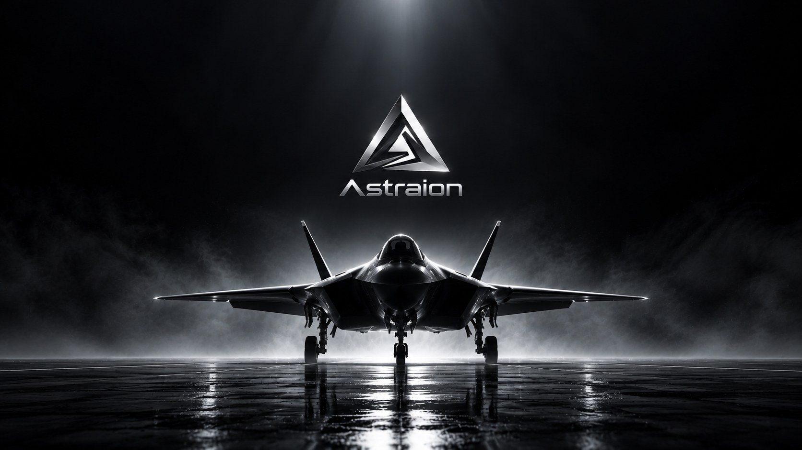
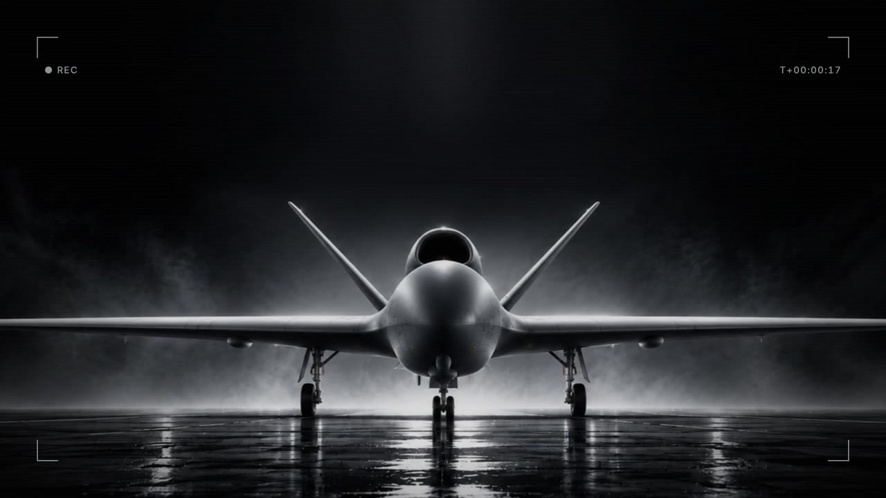
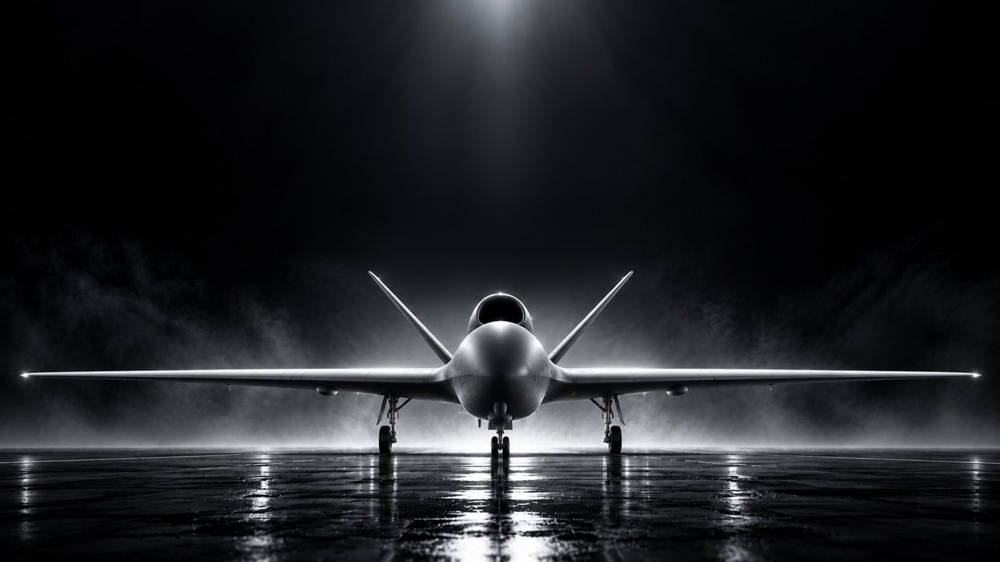
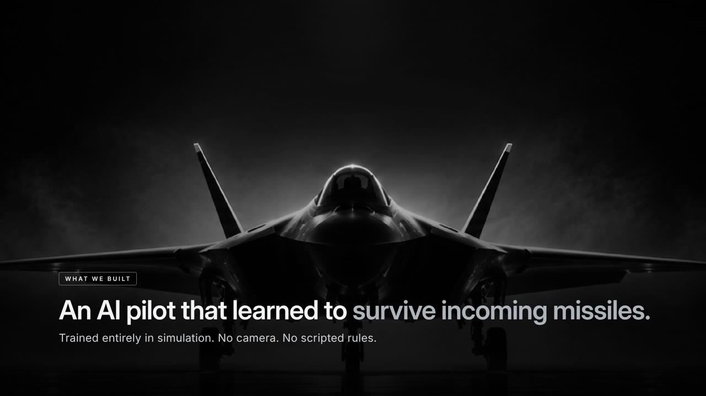
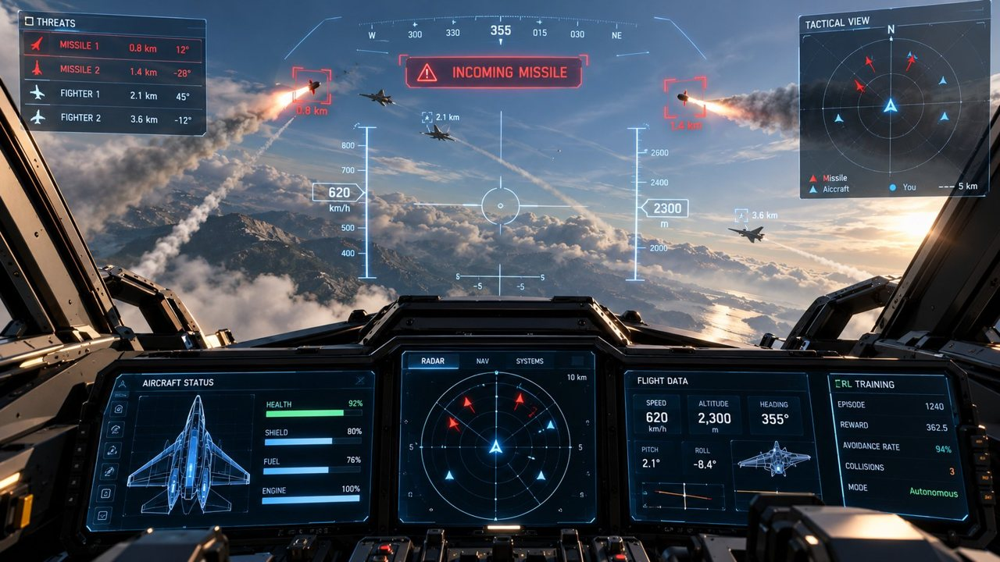

  

<h1 align="center">Project Astraion</h1>

<b>Simulation for the moments that decide a mission.</b> 
Four working prototypes for drone autonomy, crew training and pilot readiness.

---

### The problem

A lost command link. A jammed GPS signal. An incoming missile. An engine fire at low level.
These moments decide whether a mission succeeds, yet they are **too dangerous** to create in real flight, **too rare** to wait for, and **too costly** to repeat often enough to learn from.

Astraion builds realistic simulation where these moments can be created on demand, repeated exactly and measured, for crews and for AI.

### The prototypes

| | Prototype | In one line | Film |
|---|---|---|---|
|  | **01 · Drone Mission Lab** | A training simulator where drone crews practise missions going wrong, with every run scored and replayable. | [Watch](assets/video/drone-mission-lab.mp4) |
|  | **02 · GPS-Denied Drone** | A drone that finds its own way with no GPS and no pilot, using maps it carries onboard. | Demonstration on request |
|  | **03 · AI Pilot** | An AI that learns to survive incoming missiles by trial and error, seeing only what its radar sees. | [Watch](assets/video/ai-pilot.mp4) |
|  | **04 · XR Cockpit** | A fighter cockpit inside a VR headset, where pilots rehearse emergencies and missions over real terrain. | [Watch](assets/video/xr-cockpit.mp4) |

**Overview film:** [Watch](assets/video/overview.mp4)

**Simulation demos:** [Drone Mission Lab](assets/video/drone-mission-lab-demo.mp4) · [AI Pilot](assets/video/ai-pilot-demo.mp4) · [XR Cockpit](assets/video/xr-cockpit-demo.mp4)

### Working together

1. **Demonstration** — all four prototypes, on site or remote.
2. **Scenario pilot** — we rebuild one aircraft, mission or threat from your programme and run it with your people.
3. **Joint evaluation** — a defined study with agreed measures and results you can take into your own programme.

**Private demonstrations for defence partners and investors.**
[Request a briefing](https://www.linkedin.com/in/surajit-saikia-phd-55b717101/)

Prototypes shown are for demonstration. They are not certified training devices. © 2026 Astraion.
